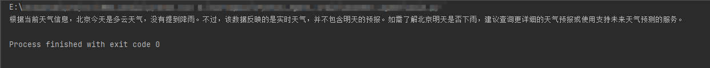

# 基于qwen-plus的简单天气查询agent

## 说明：
本项目基于通义千问qwen-plus构建了一个简单的天气查询agent，通过Langchain集成，调用DashScope OpenAI兼容接口实现。

## 技术栈：
- Python 3.10
- Langchain 1.4
- DashScope (阿里云百炼，OpenAI兼容协议)
- 通义千问qwen-plus
- python-dotenv

## 运行方法：

1. 安装依赖：
    ```bash
    pip install -r requirements.txt
    ```

2. 配置环境变量：

   windows:
    ```bash
    copy .env.example .env
    ```
   
   Mac/Linux:
    ```bash
    cp .env.example .env
    ```
   
3. 运行代码：
    ```bash
    cd weather_agent
    python main.py
    ```
   
## 项目结构
```
Python_Agent_train/
├── .env.example           # 环境变量模板
├── .gitignore             # Git 忽略规则
├── README.md              # 项目说明
├── requirements.txt       # 直接依赖清单
├── docs/                  # 文档与截图资源
│   ├── target.me          # 学习前的技能清单笔记
│   └── screenshot.png     # 运行结果截图
└── weather_agent/         # Agent 源码包
    ├── main.py            # 程序主入口
    ├── config.py          # 常量配置
    ├── step1_hello_llm.py # Lv.1 冒烟测试：验证 Qwen 连通性
    ├── step2_mock_tool.py # Lv.2 数据层：确定性 mock 天气
    ├── step3_wrap_tool.py # Lv.3 框架层：用 @tool 让 LangChain 认识函数
    └── step4_full_agent.py # Lv.4 组装层：LLM + Tool + ReAct 循环跑通
    
```
> 项目按 4 级台阶递进搭建，每级都能独立运行、独立调试。
> 这样拆分的原因：LLM 输出不稳定，小步快跑才能定位是 Agent 层的锅还是 Tool 层的锅。
> Lv.2 → Lv.3 的分离尤其关键：数据层不依赖框架，方便测试和复用。

## 运行结果


## 收获
1. 没有意义的import应当删除
2. 用zlib.crc32把城市名映射到候选列表的索引，实现同输入同输出。Python内置hash()有跨进程随机化陷阱，不可用于确定性场景。
3. docstring很重要，@tool会把函数docstring作为工具描述注入系统提示词。LLM就是靠这句话决定要不要调用工具、如何填参数。docstring写的烂，Agent就不会用你的工具
4. system_prompt约束能压制LLM幻觉，不干净的docstring会加剧甚至造成幻觉
5. 找不到变量就查API真实签名
6. 多轮对话记忆用 checkpointer + thread_id 实现，thread_id 是会话身份证，InMemorySaver 重启失忆，生产需换持久化方案

## 下一步
-  接真天气API
- 迁移到LangGraph，加可视化流程


   
   


